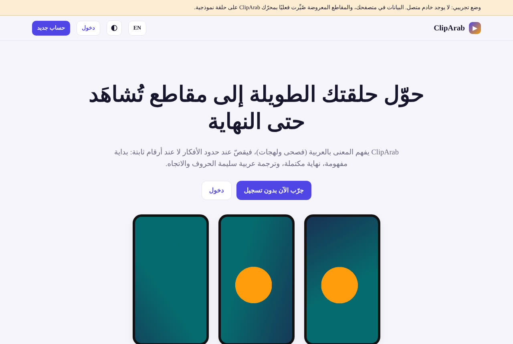
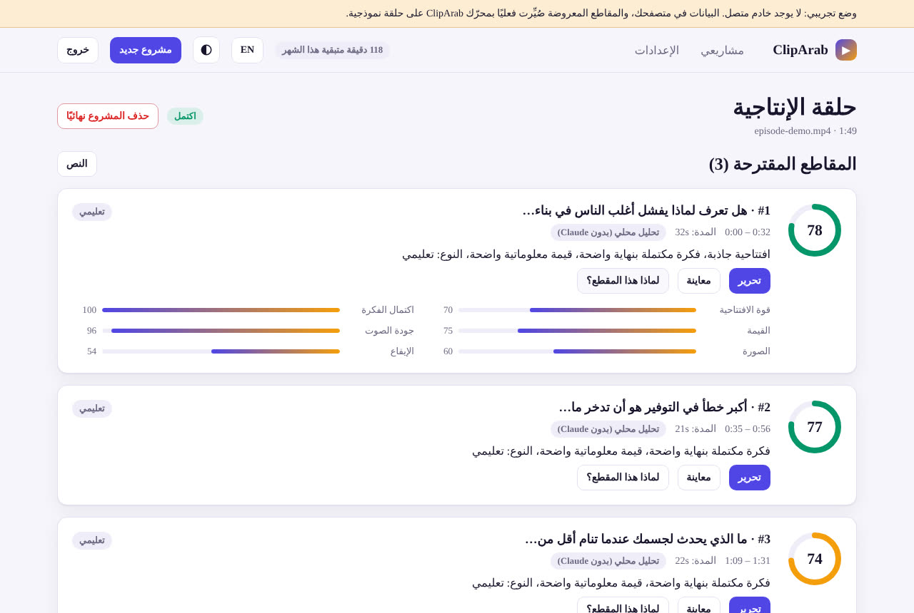
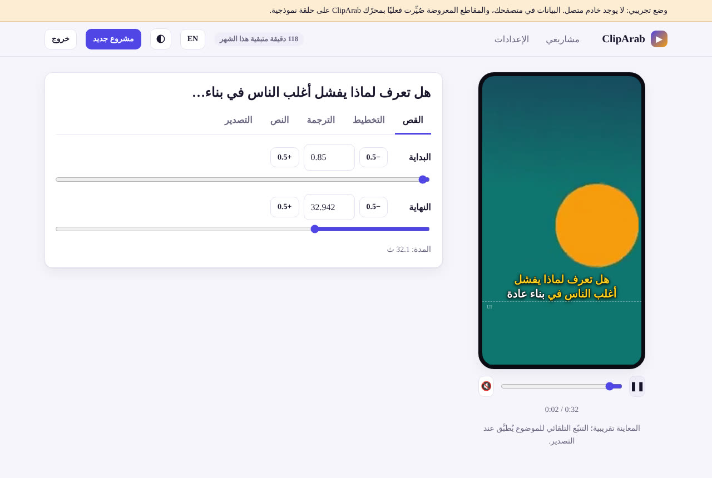

# ClipArab — كليب عرب

منصة عربية تحوّل **الفيديو الطويل إلى مقاطع قصيرة** جاهزة لـ TikTok وReels وShorts. تفهم المعنى بالعربية (فصحى ولهجات)، فتقصّ عند **حدود الأفكار** لا عند أرقام ثابتة: بداية مفهومة، نهاية مكتملة، وترجمة عربية سليمة الحروف والاتجاه. الخطة المجانية **بلا علامة مائية**.

| الرئيسية | المقاطع المقترحة + شرح التقييم | المحرّر |
|---|---|---|
|  |  |  |

> هذا المستودع هو التنفيذ الفعلي لوثيقة المنتج والمواصفات (Monorepo). اقرأ **«ما يعمل وما لم يُختبر»** أدناه قبل الاعتماد عليه.

## ما يعمل وما لم يُختبر

| المكوّن | الحالة |
|---|---|
| `packages/core` — تحليل النص العربي، التقسيم لجمل وفصول، توليد المقاطع وإصلاح الحدود، ClipScore، التتبع وإعادة التأطير 9:16، الترجمة العربية RTL، تصيير FFmpeg | ✅ مُختبر (33 اختبارًا، تشمل تصييرًا فعليًا وفحص بكسلات الترجمة) |
| `apps/api` — واجهة `/v1`، الرفع والاستيراد من رابط، المهام، الحذف النهائي، روابط المراجعة | ✅ مُختبر (34 اختبار تكامل على خادم uvicorn حقيقي + FFmpeg حقيقي) |
| `apps/web` — **النسخة المجانية داخل المتصفح** (بدون خادم): قراءة الصوت بـ WebCodecs، تفريغ الكلام بـ Whisper داخل المتصفح، نفس محرّك التقييم العربي منقولًا إلى TypeScript (`lib/local/`)، أفضل لقطة لكل مقطع، وتصدير 9:16 مع الترجمة | ✅ مُختبر في Chrome حقيقي: `e2e.mjs` (الحلقة النموذجية حتى التصدير وفحص الصوت والترجمة)، `e2e-long.mjs` (ملف 30 دقيقة وWebM)، `e2e-url.mjs` (الروابط وملفات SRT). ✅ Whisper جُرِّب على متصفح حقيقي على الموقع المنشور (التحميل والتشغيل والطوابع الزمنية). whisper-base أُسقط لأنه لا يصلح للعربية. ⚠️ دقة whisper-small على كلام عربي حقيقي لم تُقَس بعد، وفي الاختبارات الآلية يُستبدل النموذج بمحاكاة (لا إنترنت) |
| `db/schema.sql` — مخطط Postgres مع RLS | ✅ حُمّل واختُبر على Postgres 16. ⚠️ الـ API يستخدم SQLite افتراضيًا؛ نقل طبقة `Db` إلى Postgres لم يُنجز |
| Claude (فهم السياق) / Whisper (التفريغ) | ⚠️ الكود مكتوب والمنطق مُختبر بمحاكاة الاستجابات، **لكن لم يُجرَّب بمفاتيح حقيقية**. بدون مفتاح Claude يعمل «حكم محلي» أضعف |
| Docker وCI | ⚠️ مكتوبان لكن لم يُشغَّلا هنا (لا Docker) |
| تتبّع الوجوه (MediaPipe) | ⚠️ اختياري ولم يُختبر (يحتاج ملف نموذج `FACE_MODEL_PATH`)؛ البديل المُختبر: تتبّع الحركة |

## تجربة سريعة

**1) النسخة المجانية (بدون خادم) — كل المعالجة داخل متصفح الزائر**
```bash
cd apps/web && npm install && npm run dev      # http://localhost:3000 → «ابدأ الآن» (لا تسجيل دخول ولا حساب)
```
بدون `NEXT_PUBLIC_API_URL` يعمل الموقع بالكامل في المتصفح: يُرفع الفيديو إلى ذاكرة المتصفح فقط (IndexedDB)، يُفرَّغ الكلام بـ Whisper
(يُحمَّل نموذج whisper-small بدقة 8 بت مرة واحدة من CDN، حوالي 250 ميجابايت، ويعمل بعدة أنوية لأن الموقع معزول cross-origin)، وتُقترح المقاطع وتُصدَّر. الفيديوهات الطويلة: يُفرَّغ أهم 10 دقائق
من الكلام فقط. العيّنة المعروضة للزوار (`public/demo/showcase.json`): مقابلة عربية حقيقية من ويكيميديا كومنز (CC BY 3.0) فُرِّغت بـ whisper-large-v3-turbo واختار مقاطعها المحرّك؛ صُحّحت يدويًا كلمات قليلة في ترجمة المقاطع الثلاثة المعروضة. القيود: استيراد روابط يوتيوب يحتاج خادمًا (غير متاح مجانًا)، والتصدير يتم بالسرعة الطبيعية للمقطع ويحتاج إبقاء الصفحة ظاهرة.

**2) المحرّك من سطر الأوامر (بدون أي خادم)**
```bash
pip install -e packages/core           # + FFmpeg مثبّت على الجهاز
cliparab analyze episode.mp4 --srt episode.srt --llm heuristic --workdir out
cliparab render  episode.mp4 c01 --workdir out --layout fill --caption-style karaoke
```
بدون `--srt` يُستخدم Whisper (`pip install -e "packages/core[whisper]"`). مع `ANTHROPIC_API_KEY` يُستخدم Claude للتقييم.

**3) المنصة كاملة (API + عامل + ويب)**
```bash
cp .env.example .env     # أضف مفاتيح Claude/OpenAI إن وُجدت
docker compose up --build        # http://localhost:3000   (WITH_WHISPER=1 لتفريغ محلي)
```

## استيراد فيديو من رابط (يوتيوب وغيره)
في «مشروع جديد» اختر **من رابط** والصق رابط الفيديو بدل رفع ملف. يعمل هذا مع الـ API الحقيقية (وليس الوضع التجريبي): ينزّل العامل الفيديو بواسطة **yt-dlp** (مثبّت تلقائيًا في صورة Docker مع مكوّن yt-dlp-ejs ومحرك **Deno** اللازمين ليوتيوب؛ محليًا: `pip install "yt-dlp[default]"` وثبّت [Deno](https://deno.com)) ثم يكمل التحليل كأي ملف مرفوع.
- روابط https عامة فقط؛ الفيديوهات الخاصة أو المحمية لا تعمل، ويُرفض `localhost` والعناوين الداخلية. الحد الأقصى للطول والحجم هو نفسه حد الرفع (`MAX_SOURCE_MINUTES`، `MAX_UPLOAD_MB`).
- يوتيوب يحجب كثيرًا عناوين مراكز البيانات أو يطلب تسجيل دخول. إن فشل التنزيل على خادمك فمرّر ملف كوكيز عبر `YTDLP_COOKIES_FILE`، وحدّث yt-dlp بانتظام (`pip install -U yt-dlp`).
- للتحقق من رابط حقيقي على جهازك/خادمك قبل استخدام الواجهة: `python scripts/try-url.py "<الرابط>"` (يطبع سبب الفشل بالضبط).
- استخدم فقط فيديوهات تملك حقوقها أو إذنًا باستخدامها؛ التنزيل من بعض المنصات قد يخالف شروط استخدامها.

## النشر على Vercel (الواجهة)
1. Import للمستودع من Vercel، واجعل **Root Directory = `apps/web`** (Framework: Next.js يُكتشف تلقائيًا).
2. بدون أي متغيرات: تعمل **كوضع تجريبي** كاملًا.
3. لربطها بخادم حقيقي: أضف `NEXT_PUBLIC_API_URL=https://api.example.com` وفعّل `CORS_ORIGINS` في الـ API بنطاق الواجهة.

> معالجة الفيديو (FFmpeg/Whisper) لا تعمل على Vercel؛ تُشغَّل الـ API والعامل عبر Docker على أي خادم (VPS / Fly / Railway / Render).

## هيكل المستودع
```
packages/core     مكتبة المعالجة (بايثون): text_ar، candidates، scoring، reframe، captions، render، pipeline، providers
apps/api          واجهة /v1 (Starlette + Pydantic) + عامل المهام + SQLite
apps/web          Next.js (App Router) عربي RTL + وضع تجريبي + test-harness للمتصفح
db/               مخطط PostgreSQL مع RLS (+ pgvector اختياري)
infra/docker      Dockerfiles    ·   docker-compose.yml
docs/             ARCHITECTURE.md · API.md
```

## كيف يعمل التقييم (ClipScore)
`ClipScore = 20·Hook + 25·Complete + 20·Value + 10·Audio + 10·Visual + 15·Engage − Penalties` (من 0 إلى 100).
- **حدود الجمل لا الثواني**: المرشّحات تبدأ وتنتهي عند حدود جمل؛ البداية التي تفتح بضمير بلا مرجع (هذا/هو/ده/«و…» التابعة) تُصلَح بسحب الجملة السابقة، والنهاية المبتورة تُمدَّد.
- **لا انحياز للصوت العالي**: الإيقاع يُقارَن بإيقاع المتحدث نفسه (z-score) وبسقف أقل من 1.
- **رفض صارم** لعبارات الختام/الانتقال («شكرًا لكم»، «ننتقل لموضوع ثاني»)، وللمقاطع التي تعبر موضوعين أو تُفهم بشكل غير مستقل، مع تنويع (MMR) وإزالة التداخل > 30%.
- كل مقطع يحمل **تفصيل التقييم وسببًا بالعربية** («لماذا هذا المقطع؟»).

## الخصوصية والجانب القانوني
- لا تدريب على بيانات المستخدم دون موافقة صريحة (`allow_training = false` افتراضيًا).
- **لا حسابات ولا كلمات مرور ولا خطط ولا حدود دقائق.** كل متصفح يحصل على مفتاح عشوائي يعزل مشاريعه عن غيره (ضياع بيانات المتصفح = ضياع الوصول لمشاريعه). بلا تسجيل دخول، فإن جعلت الـ API عامة على الإنترنت فكل من يصل إليها يستطيع استخدام موارد خادمك (التحليل والتنزيل)؛ ضعها خلف جدار حماية أو شبكة خاصة أو وكيل بكلمة سر إن لم تُرد ذلك.
- حذف نهائي للمشروع، ولكل بيانات هذا المتصفح من «الإعدادات» (ملفات + صفوف) وحذف تلقائي بعد `RETENTION_DAYS`؛ الملفات المصدَّرة تنتهي بعد `EXPORT_TTL_HOURS`.
- نستورد فقط ما يرفعه المستخدم أو يرسل رابطه (روابط عامة عبر yt-dlp)، ويجب أن يملك حقوقه أو إذنًا باستخدامه. لا نتجاوز أي حماية (فيديو خاص أو مشفّر) ولا ننشر مباشرةً على المنصات.
- فعّل HTTPS خلف وكيل عكسي في الإنتاج: المفتاح العشوائي في الترويسة هو الهوية الوحيدة.

## الاختبارات
```bash
pip install -e packages/core -e apps/api pytest requests opencv-python-headless
python -m pytest packages/core/tests apps/api/tests      # يتطلب ffmpeg
(cd apps/web/test-harness && ./build.sh) && node apps/web/test-harness/e2e.mjs   # يتطلب Playwright وChrome
psql cliparab -f db/schema.sql && psql cliparab -f db/tests/rls_test.sql          # عزل الفرق
```

## ما لم يُبنَ بعد (خارطة الطريق)
تطبيق الجوال (Expo) · فصل المتحدثين (pyannote) وتحديد اللهجة · نموذج وجوه للتتبع · قوالب وهوية بصرية (Brand Kit) · فرق وصلاحيات · الدفع والاشتراكات · استيراد عبر واجهات المنصات الرسمية · النشر المباشر عبر الواجهات الرسمية · محوّل Postgres للـ API · طابور Redis عند الحاجة لتوسّع أكبر.

*لم يُحدَّد ترخيص للمستودع بعد؛ أضِف ملف LICENSE يناسبك.*
